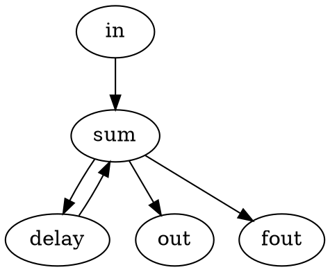
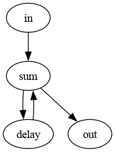
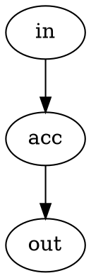

# dspflow

A digital systems simulator. Describe a digital system as a graph of basic
building blocks using the Graphiz `.dot` file format, then run the simulator.
It streams data samples through the graph and dumps the output data into files.


## Build

Java program:
```sh
make      # compile Java classes
make jar  # create an executable jar
make test # run JUnit tests
```


## Usage

Arguments: `<graph.dot> [iterations]`

```sh
java -cp bin Main examples/integrator.dot 8
```
or
```sh
java -jar dspsim.jar examples/integrator.dot 8
```

Once you have run the simulation and the data you care about got dumped into a
file like out.csv, then you can visualize this data using the python script in
this repository. First install the dependencies:

```sh
pip install -r requirements.txt
```

Then run the script:

Windows:
```sh
python python/plot.py examples/out.csv
```

MacOS / Linux:
```sh
python3 python/plot.py examples/out.csv
```


## Graph File Format

See the Graphviz documentation at [https://www.graphviz.org/documentation/](https://www.graphviz.org/documentation/)
for more details.



For now, the simulator program is headless. However, I found that this online
Graphviz tool is very helpful. [https://magjac.com/graphviz-visual-editor/](https://magjac.com/graphviz-visual-editor/)




## Nodes

The `type` attribute selects the node (case-insensitive):

| Type         | Parameters                                 | Inputs | Outputs |
|--------------|--------------------------------------------|:------:|:-------:|
| constant     | int value                                  | 0      | 1       |
| impulse      |                                            | 0      | 1       |
| sine         | int amplitude, int period, int phase = 0   | 0      | 1       |
| datain       | string file                                | 0      | 1       |
| gain         | int value                                  | 1      | 1       |
| lshift       | int value                                  | 1      | 1       |
| rshift       | int value                                  | 1      | 1       |
| sum          |                                            | 2+     | 1       |
| multiplier   |                                            | 2      | 1       |
| delay        | int delay = 1                              | 1      | 1       |
| integrator   |                                            | 1      | 1       |
| comb         | int value = 1                              | 1      | 1       |
| decimator    | int ratio                                  | 1      | 1       |
| interpolator | int ratio                                  | 1      | 1       |
| hold         | int ratio                                  | 1      | 1       |
| dataout      | string file = stdout                       | 1      | 0       |


## Bus widths

By default a bus (edge) carries unbounded integers. Give it a width in bits
with a `w` attribute on the edge:



A `w`-bit bus holds `w`-bit two's complement values, modelling a wire slice
`[w-1:0]`:

- Nodes compute in full precision. The result is then wrapped to the low `w`
  bits of each output bus, so overflow wraps (`127 + 1` becomes `-128` on 8
  bits). Saturation would need extra logic in hardware and is not modelled.
- A narrower value on a wider bus is sign-extended, which leaves its value
  unchanged.
- Nodes with memory (delay, comb, hold, decimator, interpolator) store what
  arrives on their input bus, at the input width.
- The integrator's register *is* its output, so it behaves as an accumulator
  of its output bus width. That is what a CIC filter needs.
- Narrowing drops the top bits. To drop low bits instead (the usual way to
  narrow a DSP signal), put an `rshift` before the narrow bus.
- One node may drive buses of different widths. Each destination gets its own
  slice.

In the GUI, right-click a wire and pick **Bit width**. A width can be a number
or a macro name, and only wires with a width set show the `/N` mark. Inside a
sub-diagram, a width can be one of its macros, so it can be set per instance.
Where a wire enters or leaves a sub-diagram through a port, the narrower of the
two widths applies.


## Sub-diagrams (GUI)

A sub-diagram is an ordinary `.dsg` file containing `inport` / `outport`
blocks (numbered by their `index`). Place one from the palette's
Sub-diagram section (the shipped `blocks/` library, or Load… for any `.dsg`)
and wire its ports like any other block. Double-click a placed sub-diagram to
open and edit its definition; saved edits show up in every diagram that links
it. The sub-diagram's macros are its parameters: set them per instance in
Properties…, or leave them blank to keep the sub-diagram's own values.

Compiling flattens sub-diagrams into basic nodes named `<instance>_<block>`,
so the engine and the `.dot` format are unchanged.

The `blocks/` library has two kinds of N-way multiplexer:

| Block           | Rate                     | Output                                         |
|-----------------|--------------------------|------------------------------------------------|
| `muxN`          | same as input            | `y[n] = x_{n mod N}[n]` (other samples dropped) |
| `demuxN`        | same as input            | `y_k` latches `x` on clock `k` of each frame and holds it for the next frame |
| `interleaveN`   | output N× the input      | `y[Nn+k] = x_k[n]` (every sample kept)          |
| `deinterleaveN` | output 1/N of the input  | `y_k[n] = x[Nn-N+k]`                           |

The counting `muxN`/`demuxN` model single-clock hardware, where a counter
drives the select. The mux's counter is an impulse recirculating through
`z^-N`. The engine runs every source on the base clock, so the counter counts
base-clock samples. `interleaveN`/`deinterleaveN` are the lossless multirate
versions, e.g. the commutator in a polyphase filter. See
`examples/muxdemux.dsg` and `examples/interleave.dsg`.


## Data File Format

The data within the file expected by the datain node and created by the dataout
node is a column of comma separated values (the true separator is ,\n). For the
input data file, the list of values is the first contiguous slice of valid
numbers. Text before and after this are ignored. Any blank lines will end the
list. If more samples are requested from a datain node than it has data values,
it will return zeros.

### Example

```csv
Some Title,
1,
2,
3,
the following is ignored,
4,
5,
```


## Citations

[1] E. A. Lee and D. G. Messerschmitt, "Synchronous data flow," in Proceedings of the IEEE, vol. 75, no. 9, pp. 1235-1245, Sept. 1987

[2] E. A. Lee and D. G. Messerschmitt, "Static Scheduling of Synchronous Data Flow Programs for Digital Signal Processing," in IEEE Transactions on Computers, vol. C-36, no. 1, pp. 24-35, Jan. 1987

